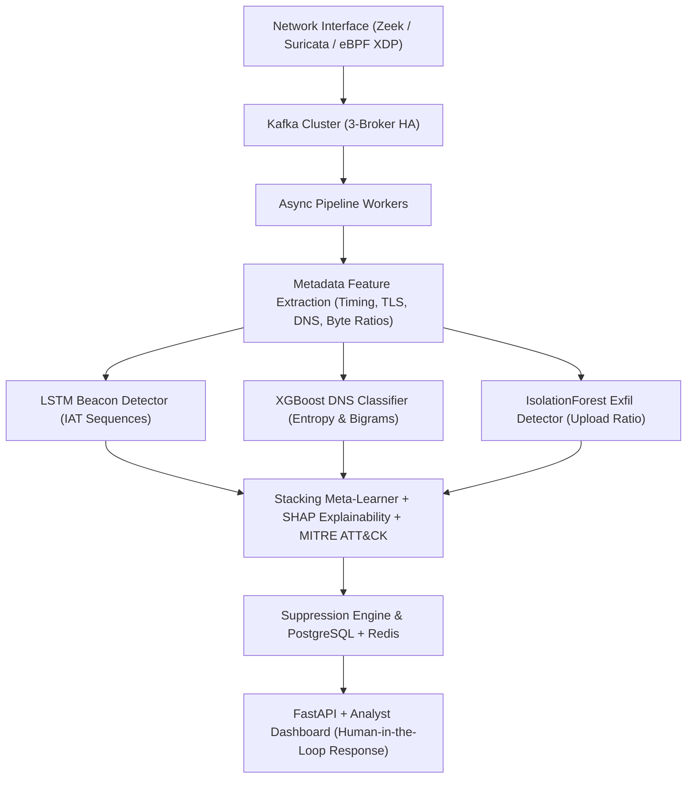

# PhantomFlow
**Research prototype: ML-based detection of covert channels in encrypted network traffic from metadata only.**

A research prototype that aims to detect C2 beaconing, DNS tunnelling and data exfiltration from packet and flow metadata, without decrypting traffic. Only the flow-level detector has been evaluated on public data, and it does not yet generalise across networks: see [Evaluation results and limits](#evaluation-results-and-limits).

---

## Architecture Overview



```
Network Interface (Zeek/Suricata)
        ↓
  Kafka (3-broker HA cluster)
        ↓
  Pipeline Workers (async, N replicas)
        ↓
  Feature Extraction                    ← timing, TLS, DNS, byte features
        ↓
  ML Ensemble Inference
  ├── LSTM Beacon Detector              ← IAT sequences → C2 periodicity
  ├── XGBoost DNS Classifier            ← entropy, bigrams → DNS tunneling
  └── IsolationForest Exfil Detector    ← bytes ratio → data exfiltration
        ↓
  Meta-Learner (Logistic Regression)
  + SHAP Explainability
  + MITRE ATT&CK Mapping
        ↓
  Suppression Engine → PostgreSQL → SIEM
        ↓
  FastAPI + Analyst Dashboard
  + Active Response (Human-in-the-Loop)
```

---

## Quick Start

### Prerequisites
- Python 3.11+
- Docker & Docker Compose
- 8GB+ RAM recommended

### 1. Clone and install
```bash
git clone https://github.com/Ashin-06/PhantomFlow.git
cd PhantomFlow

cp .env.example .env
# Edit .env with your credentials

pip install -r requirements.txt
```

### 2. Start infrastructure
```bash
docker compose -f docker/docker-compose.yml up -d
# Starts: Kafka, Redis, PostgreSQL
# This Compose file exposes PostgreSQL on port 5433; .env.example already matches it.
```

### 3. Initialize the database
The Compose Postgres creates the tables from `pipeline/schema.sql` the first time it starts. For a database that already existed, load the schema yourself:
```bash
psql -h localhost -p 5433 -U phantom -d phantomflow -f pipeline/schema.sql
```

### 4. Train the models (streaming — no full download needed)
```bash
# Quick test (100K rows per dataset, ~15 mins)
python -m train.run_online --max_rows 100000

# Full training (~3-4 hours, ~500MB RAM peak)
python -m train.run_online

# Track training progress
mlflow ui   # → http://localhost:5000
```

### 5. Start the pipeline
```bash
# Start the async detection pipeline
python -m pipeline.orchestrator

# Start the API
uvicorn api.main:app --host 0.0.0.0 --port 8000

# Dashboard → http://localhost:8000/dashboard
```

### 6. Production deployment
```bash
docker compose -f docker/docker-compose.prod.yml up -d
```

---

## Training Datasets

Training uses online streaming — data is fetched and processed chunk-by-chunk without downloading entire files.

| Dataset | Content | Rows |
|---------|---------|------|
| CICIDS 2017 (Mon-Fri) | Benign, Botnet C2, DoS, Exfil | ~2.1M |
| CICIDS 2018 (S3) | Botnet, Infiltration | ~1M |
| CTU-13 (Scenarios 1, 9) | Neris botnet C2. Background flows are unlabelled and are excluded in `evaluation/`. | ~4M |
| UNSW-NB15 | Backdoors, Shellcode | ~175K |
| DNS Exfil (Zeek log) | DNS tunneling | ~50K |

---

## Detection Capabilities

| Threat | Technique | MITRE TTP |
|--------|-----------|-----------|
| C2 Beaconing | LSTM on IAT sequences, JA3 fingerprinting | T1071.001, T1573 |
| DNS Tunneling | Shannon entropy, bigram analysis | T1048.003, T1071.004 |
| Data Exfiltration | Upload ratio anomaly, IsolationForest | T1041, T1048 |

---

## Evaluation results and limits

The evaluation of record is `python -m evaluation.run` (pinned in
`evaluation/config.toml`; data fetched with sha256 checks by
`python -m evaluation.download`). Full tables and the reasoning behind them are
in [docs/EVALUATION.md](docs/EVALUATION.md). The audit that led to it is in
[docs/AUDIT.md](docs/AUDIT.md).

Summary, with XGBoost on the 7 flow features that CICIDS2017 and CTU-13 share,
without the destination port, and with thresholds chosen on validation only:

| Setting | PR-AUC | F1 | FPR |
|---|---|---|---|
| CICIDS2017, all attacks vs benign, time split | 0.993 | 0.983 | 0.002 |
| CTU-13 scenario 9 (Neris, family seen in training), scenario split | 0.990 | 0.952 | 0.256 |
| CTU-13 scenario 8 (Murlo, unseen family), scenario split | 0.841 | 0.383 | 0.267 |
| Train CICIDS2017, test CTU-13 scenario 9 | 0.918 | 0.000 | 0.000 |
| Train CTU-13, test CICIDS2017 botnet | 0.002 | 0.001 | 0.885 |

PR-AUC must be read against prevalence: 0.861 on CTU-13 s9, 0.078 on s8 and
0.0005 for the CICIDS2017 botnet test.

What this means:

* **Within one dataset** the flow features separate attacks well. CICIDS2017
  contains known shortcuts, though; the destination port alone separates its
  botnet class at ROC-AUC 0.995.
* **Across datasets the detector does not generalise.** A threshold calibrated
  on one dataset either never fires on the other or flags most benign flows.
  The feature-to-label relation reverses between the two datasets.
* **Per-capture normalisation and class weighting were tested and did not
  help** (negative results in docs/EVALUATION.md).
* **Not evaluated:** the TLS, JA3/JA4, QUIC, DoH and DNS-tunnelling features, the
  LSTM beacon detector, the Isolation Forest exfiltration detector and the
  stacked ensemble. The public flow datasets used here do not contain the inputs
  those components need. No claim is made about their detection performance.
* Earlier figures (`eval/eval_*.json`, `eval/final_results.json`, and a former
  "CICIDS 2018 F1 1.000" and "100% recall" in this README) came from flawed
  evaluations: model selection on the test set, single-class samples and
  label-mapping bugs. They are superseded.

API and dashboard regression tests: `python -m pytest -q` (see
[audit notes](docs/audit-2026-10-09.md)).

## Project Structure

```
phantomflow/
├── api/                    # FastAPI backend, RS256 JWT auth, RBAC
│   ├── auth.py             # JWT verification + LDAP/AD integration
│   └── routes/
│       └── analyst.py      # Analyst review, suppression, FP metrics
├── capture/                # Packet capture (Zeek/Suricata interface)
├── config/
│   ├── logging.py          # Structured JSON logging → ELK
│   └── secrets.py          # AWS Secrets Manager / Vault integration
├── dashboard/              # Frontend UI
├── docker/
│   ├── docker-compose.yml         # Dev: single-node
│   └── docker-compose.prod.yml    # Prod: Kafka HA, Redis Sentinel, PG replica
├── features/               # Feature extraction (timing, TLS, DNS, bytes)
├── lab/                    # Dataset tools
│   ├── online_datasets.py  # Streaming dataset registry (URLs + configs)
│   ├── stream_reader.py    # HTTP/S3 streaming reader
│   └── feature_adapter.py  # Per-dataset column normalization
├── models/                 # ML model implementations
│   ├── lstm_beacon.py      # LSTM beacon detector
│   ├── dns_classifier.py   # XGBoost DNS tunnel classifier
│   ├── exfil_detector.py   # IsolationForest exfil detector
│   └── ensemble.py         # Stacking ensemble + SHAP + MITRE
├── monitoring/
│   ├── drift_detector.py   # KS-test + ADWIN concept drift detection
│   └── metrics.py          # Prometheus metrics
├── pipeline/
│   ├── orchestrator.py     # Kafka consumer → ML inference → alerts
│   ├── db_layer.py         # Async PostgreSQL (asyncpg connection pool)
│   ├── suppression.py      # Analyst suppression rules engine
│   ├── active_response.py  # Human-in-the-loop blocking actions
│   └── schema.sql          # Full PostgreSQL schema
├── sensors/
│   └── manager.py          # Sensor fleet health + config management
├── tests/
│   └── test_integration.py # Integration test framework
└── train/
    ├── run_online.py        # ← START HERE: trains all models
    ├── online_trainer.py    # Streaming incremental trainer
    ├── online_evaluator.py  # Held-out dataset evaluation
    ├── validation_pipeline.py # 8-check pre-training validator
    ├── model_registry.py   # MLflow promotion gates
    ├── federated.py        # Federated averaging (multi-org)
    └── active_learning.py  # Uncertainty sampling for analyst review
```

---

## Security Architecture

- **JWT**: RS256 asymmetric tokens (validation doesn't need private key)
- **RBAC**: Tier1/Tier2/Tier3 analyst roles via LDAP/Active Directory
- **Secrets**: AWS Secrets Manager / HashiCorp Vault integration in `config/secrets.py`. Local setups read `JWT_SECRET` and other values from `.env`.
- **Active Response**: actions can be queued for analyst review. Execution returns 501 until an enforcement provider is wired in, so nothing is blocked automatically.
- **Suppression**: CIDR + port + SNI regex rules to reduce alert fatigue
- **Audit Log**: response actions are recorded with the approving analyst (append-only by convention, not enforced by the database).

---

## Research components (experimental)

These modules exist as code but have **not** been evaluated end to end:

- **Federated learning** (`train/federated.py`): weight averaging across deployments.
- **Active learning** (`train/active_learning.py`): uncertainty sampling for analyst review.
- **Concept drift detection** (`monitoring/drift_detector.py`): ADWIN and KS tests.
- **Cross-dataset validation**: implemented in `evaluation/`. It currently shows
  that the model does **not** generalise from CICIDS2017 to CTU-13 (see above).

## Audited API and dashboard setup

The API no longer accepts the `demo` token. Configure a random `JWT_SECRET`
(at least 32 characters; do not use the example placeholder) or provide matching
`JWT_PUBLIC_KEY` and `JWT_PRIVATE_KEY` PEM strings. Signing and verification
use RS256 when a public key is configured, otherwise HS256.

For a local-only development session, explicitly set `ENV=dev` and
`ALLOW_DEV_LOGIN=true`. Sign in with a nonempty username and password `dev`.
This creates an **analyst** session. Training and database reset require an
administrator. Production login uses configured Active Directory groups.

For API/dashboard development without the ML/capture packages:

```sh
pip install -r requirements-api.txt
python -m pytest -q
uvicorn api.main:app --host 127.0.0.1 --port 8000
```

`/health` checks the API process; `/ready` checks PostgreSQL and Redis and returns
503 when either is unavailable. Start services before the API; restart the API
after restoring a database that was unavailable at startup. The Redis alert
subscription reconnects automatically. The dashboard reports outages and retains
last-known data; it does not substitute synthetic detections or training results.
**Export alerts** downloads the currently loaded feed (up to 50 alerts), not the
entire database. **Sign out** clears the session from the current browser tab.

WebSocket clients must send `{"token":"<access_token>"}` as their first message
within five seconds. Unauthenticated and expired sessions are closed.

Response actions can be queued for review. Execution/approval returns 501 until
an enforcement provider is wired into these API routes; no firewall block is
claimed or performed by this dashboard path.

See [audit notes](docs/audit-2026-10-09.md) for verification and remaining limits.
